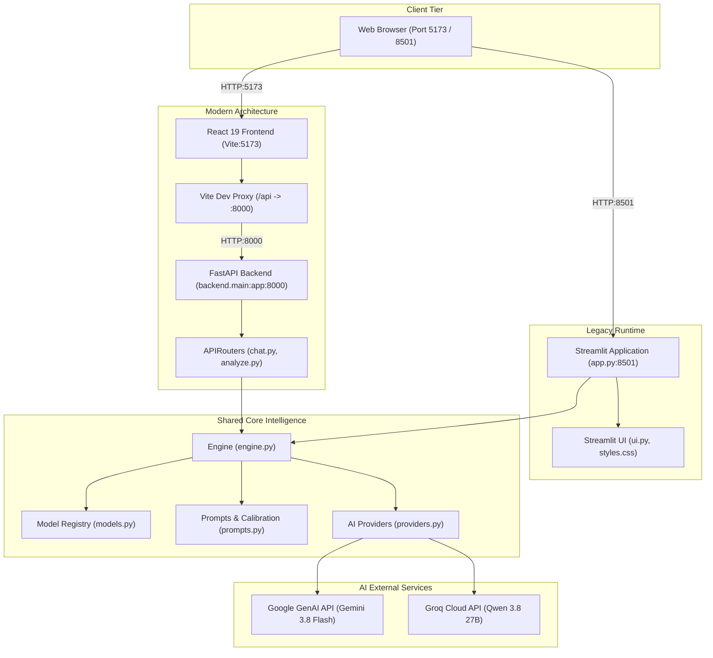
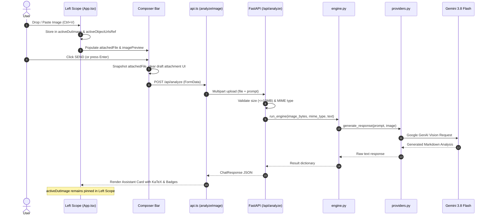
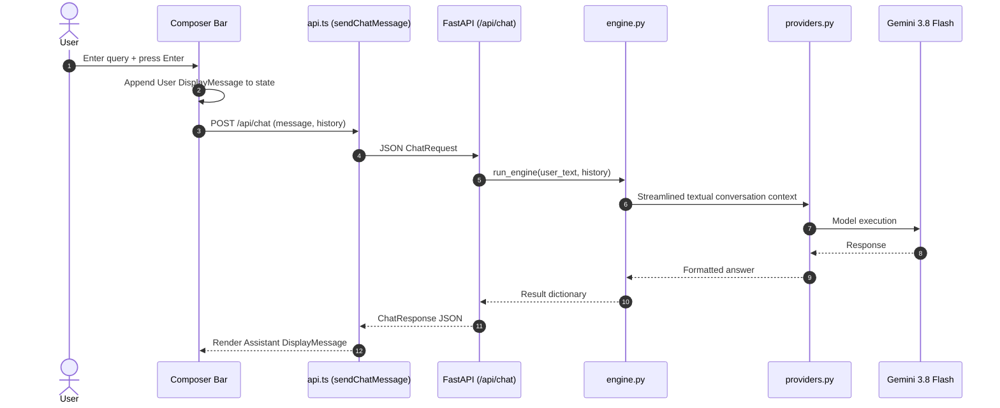
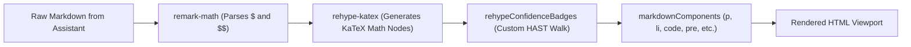

# CircuitSnap — System Architecture & Technical Specification

This document details the software architecture, runtime topology, data flows, and component specifications of the **CircuitSnap** platform.

---

## 1. System Overview & Dual-Stack Topology

CircuitSnap is an AI-powered electronics verification and diagnostic assistant tailored for Electronics and Communication Engineering (ECE) students and laboratory researchers.

The system is deployed in a dual-stack configuration during the migration from the original monolithic Streamlit application to a decoupled modern web application:



---

## 2. Shared Core Intelligence Layer

The core reasoning logic is completely decoupled from presentation frameworks, allowing Streamlit and FastAPI to share identical intelligence guarantees:

1. **`models.py` (Model Registry)**:
   - Configures model identifiers, fallback cascades, vision flags, and human-readable metadata.
   - **Primary Model**: `Gemini` (`gemini-3.8-flash`) with fallback to `gemini-3.6-flash` and `gemini-2.5-flash`.
   - **Secondary Provider**: `Groq` (`qwen/qwen3.8-27b`) acting as a high-speed alternative and cross-provider fallback.
2. **`prompts.py` (Prompt Engineering & Output Calibration)**:
   - Establishes the CircuitSnap system prompt and adaptive output calibration.
   - For basic conceptual questions, enforces succinct definitions (80–120 words) with bold lead-ins.
   - For complex circuit analysis and debugging, enforces structured point-wise explanations and verified component breakdowns.
3. **`providers.py` (AI Communication & Failover)**:
   - Encapsulates SDK client initialization (`google.genai.Client` and `groq.Groq`).
   - Retrieves API keys securely (`os.environ` $\rightarrow$ `st.secrets`).
   - Implements multi-cycle retry and cross-model/cross-provider fallback upon rate limit or service interruption.
4. **`engine.py` (Intelligence Orchestration)**:
   - Categorizes input types (`component`, `circuit_diagram`, `physical_circuit`, `electronics_document`).
   - Detects intent (`identify`, `explain`, `test`, `troubleshoot`, `calculate`, `viva`).
   - Executes multi-turn history formatting and image payload attachment before dispatching to the provider layer.

---

## 3. FastAPI Backend Architecture

Located in `backend/`, the FastAPI service provides structured, type-safe REST endpoints with automated Pydantic v2 validation.

### Request & Response Schemas (`backend/schemas.py`)
- **`ChatMessage`**: Represents an individual conversation turn:
  ```python
  class ChatMessage(BaseModel):
      role: Literal["user", "assistant"]
      content: str
  ```
- **`ChatRequest`**: Payload for `/api/chat`:
  - `message`: `str` (1 to 20,000 characters, extra fields forbidden)
  - `history`: `list[ChatMessage]` (up to 100 turns)
  - `provider`: `str | None`
  - `model_id`: `str | None`
  - `previous_visual_context`: `dict[str, Any] | None`
- **`ChatResponse`**: Standardized response for all AI operations:
  - `answer`: `str` (Markdown content with KaTeX and badges)
  - `provider`: `str`
  - `model_id`: `str`
  - `status`: `"success"` | `"error"`
  - `error_type`: `str | None`
  - `fallback_used`: `bool`
  - `attempts`: `int`
- **`HealthResponse`**: Payload for `/api/health` providing backend status and active model configuration.

### Endpoint Specifications
1. **`GET /api/health`** ([`main.py`](file:///c:/Users/jagan/CircuitSnap/backend/main.py#L44-L56)):
   - Checks service liveness and resolves default model configurations from `models.py`.
2. **`POST /api/chat`** ([`routers/chat.py`](file:///c:/Users/jagan/CircuitSnap/backend/routers/chat.py#L14-L65)):
   - Processes multi-turn textual conversations.
   - Validates provider and model parameters against `models.py`.
   - Invokes `engine.run_engine` with text and history context.
3. **`POST /api/analyze`** ([`routers/analyze.py`](file:///c:/Users/jagan/CircuitSnap/backend/routers/analyze.py#L23-L109)):
   - Accepts `multipart/form-data` uploads with file size limit enforcement (10 MB).
   - Validates MIME types (`image/jpeg`, `image/png`, `image/webp`, `image/gif`).
   - Streams chunks into memory and passes raw bytes to `engine.run_engine`.

---

## 4. React 19 Frontend Architecture

The frontend is built with React 19, TypeScript, and Tailwind CSS v4, compiled using Vite 8.

### Component Hierarchy
```text
main.tsx
└── App.tsx
    ├── TelemetryHeader.tsx
    ├── Section A: Optical Inspection Scope (Left Column)
    │   ├── Hidden File Input (<input type="file" />)
    │   ├── Pinned Optical HUD Scope Viewport
    │   │   ├── Active DUT State (Reticle Overlays, Telemetry Bar, REPLACE & EJECT)
    │   │   └── Standby Reticle (Dropzone & Paste Target)
    │   └── Workbench Quick-Action Chips
    └── Section B: Diagnostic Log & Analysis Feed (Right Column)
        ├── Feed Header & Status LED
        ├── Height-Locked Scrollable Message Stream
        │   ├── User Message Bubble (Smoked Cyan Card + Image Thumbnail)
        │   └── Assistant Message Bubble (KaTeX + ReactMarkdown + Confidence Badges)
        └── Pinned Bottom Composer Bar (Textarea + Attach Button + Emerald Send Trigger)
```

### Vite Dev Proxy (`vite.config.ts`)
```typescript
export default defineConfig({
  plugins: [react(), tailwindcss()],
  server: {
    port: 5173,
    proxy: {
      '/api': {
        target: 'http://127.0.0.1:8000',
        changeOrigin: true,
      },
    },
  },
})
```

---

## 5. End-to-End Data Flows

### A. Optical Analysis Data Flow


### B. Multi-Turn Text Conversation Flow


---

## 6. Cyber-Physical Hardware Workbench UI Layout

The layout is structured as a two-column fixed-viewport grid (`h-screen overflow-hidden`):

### 1. Pinned Top Telemetry Header (`TelemetryHeader.tsx`)
- **Dimensions**: Fixed `h-[65px]`, sticky top, acrylic frosted glass (`bg-slate-900/70 backdrop-blur-md border-b border-white/10`).
- **Hardware Status LED**: Queries `GET /api/health`:
  - `SYS ONLINE` (emerald pulse LED)
  - `INITIALIZING` (amber spin LED)
  - `SYS OFFLINE` (rose LED with click-to-refresh)
- **Telemetry Chips**: Monospace chips displaying active `PROV`, `MODEL`, `CYCLES` (attempts count), and `FALLBACK` warning badge.
- **Workbench Reset**: `RESET BENCH` action button with confirmation state detection.

### 2. Column A: Left Optical Inspection Scope (~38% width / `lg:col-span-5`)
- **Pinned Optical HUD Scope**:
  - Locked display of `activeDutImage`.
  - Tactical HUD corner reticles and translucent optical crosshairs.
  - Telemetry bar with component filename, file size, and controls:
    - **`REPLACE`**: Opens system file picker to load a new DUT without resetting chat history.
    - **`EJECT / CLEAR DUT`**: Unmounts image and returns scope to standby.
- **Standby Reticle**:
  - Activated when no image is loaded.
  - Interactive dropzone supporting drag-and-drop, direct click, and global clipboard paste (<kbd>Ctrl+V</kbd>).
- **Bench Quick-Actions Grid**:
  - 4 pre-calibrated ECE prompts: *Decode Color Bands*, *Op-Amp Pinout & Specs*, *555 Timer Config*, *Troubleshoot Short / Noise*.

### 3. Column B: Right Diagnostic Log & Analysis Feed (~62% width / `lg:col-span-7`)
- **Feed Stream**:
  - Height-locked scrollable log styled with `.diagnostic-feed-scrollbar`.
  - **User Message Bubble**: Smoked cyan instrument card (`bg-cyan-950/40 border border-cyan-800/50 text-cyan-100 shadow-[0_4px_20px_rgba(6,182,212,0.1)]`) with uploaded thumbnail bezel.
  - **Assistant Message Bubble**: Smoked slate card (`bg-slate-950/90 border border-slate-800/90`) with KaTeX formulas, single-pill confidence badges, and cycle telemetry.
- **Pinned Composer Bar**:
  - Auto-resizing textarea with <kbd>Enter</kbd> to send and <kbd>Shift+Enter</kbd> for newlines.
  - Optical scope load button.
  - Phosphor emerald trigger button (`bg-emerald-600 hover:bg-emerald-500 shadow-[0_0_15px_rgba(16,185,129,0.3)]`).

---

## 7. Rendering Pipeline & AST Transformations

To render academic ECE content cleanly without layout shifts or border glitches, CircuitSnap processes assistant Markdown through an AST pipeline:



### 1. `rehypeConfidenceBadges` Plugin
- **The Problem Solved**: Markdown parent wrappers (`li`, `p`, `span`, `strong`) previously parsed text individually, creating multiple nested borders around confidence tags.
- **AST Solution**: Operates directly on HAST text nodes. It ignores `<code>`, `<pre>`, and `.katex` nodes, splitting text on `BADGE_REGEX`:
  ```regex
  /((?:\[\s*CANNOT CONFIRM\s*\]|\bCANNOT CONFIRM\b|\[\s*CONFIRMED\s*\]|\bCONFIRMED\b|\[\s*LIKELY\s*\]|\bLIKELY\b)(?:\s*[:—–-])?\s*)/g
  ```
- **Result**: Exactly one self-contained, illuminated badge pill is injected into the tree.

### 2. KaTeX Mathematical Notation
- **Inline**: Enclosed in single dollar signs (`$V_{out} = V_{in} \cdot \frac{R_2}{R_1 + R_2}$`).
- **Display Blocks**: Enclosed in double dollar signs (`$$\omega_0 = \frac{1}{\sqrt{LC}}$$`).
- **CSS Guard**: `.katex-display` is constrained with `overflow-x: auto` to prevent long mathematical derivations from blowing out mobile or narrow split-pane containers.

---

## 8. Memory Management & Object URL Lifecycle

CircuitSnap manages image preview memory deterministically using `activeObjectUrlsRef`:

1. When a user uploads or pastes an image, an object URL is generated via `URL.createObjectURL(file)`.
2. The URL string is added to `activeObjectUrlsRef.current: Set<string>`.
3. When clearing the draft attachment (`removeAttachedFile`), `imagePreview` is revoked only if it does not equal `activeDutImage`.
4. When resetting the workbench (`handleClearChat`), `activeObjectUrlsRef` iterates through all stored URLs and executes `URL.revokeObjectURL(url)` before clearing the set.
5. On component unmount, a cleanup hook safely revokes all remaining URLs.

